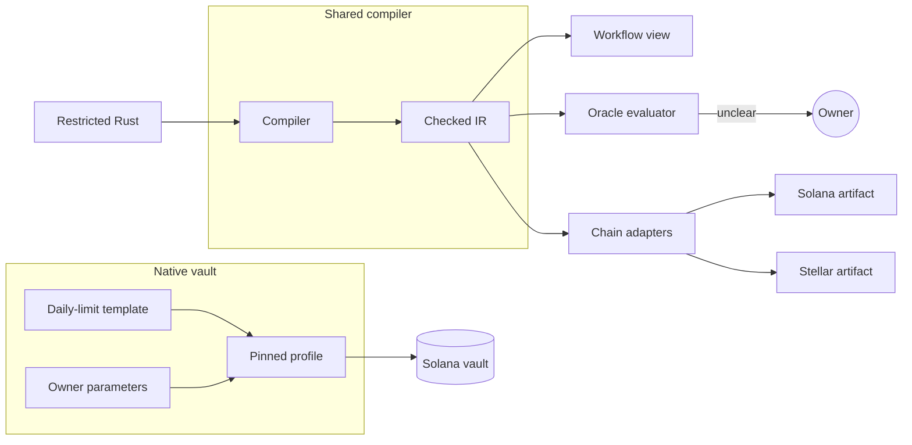

# Policy SDK

The AllowIt Policy SDK compiles and evaluates owner policies. A policy uses a restricted subset of Rust that the compiler checks. See the [SDK README](https://github.com/AllowIt-hq/allowit-sdk/blob/main/README.md), [architecture](../docs/architecture.md), [SDK reference](https://github.com/AllowIt-hq/allowit.xyz-project/blob/main/wiki/allowit/allowit-sdk.md) and [policy language](https://github.com/AllowIt-hq/allowit.xyz-project/blob/main/wiki/allowit/rust-policy-language.md).

## Rust libraries

| Library | Responsibility |
| --- | --- |
| `allowit_sdk` | Compiler, checked IR, deterministic evaluator, function registry, workflow projection, developer CLI and language server |
| `allowit_native` | Solana transactions, local signing, RPC, receipt checks and recovery |
| `allowit_tempo` | Offline verification of Tempo vault plans and authority signatures |

The compiler library has no chain dependency. `allowit_tempo` holds no keys and makes no RPC calls. It does not broadcast transactions or prove HTTP service delivery. The server engine uses `allowit_sdk` and `allowit_native`. The action CLI uses all three libraries.

## Two command-line tools

The SDK developer CLI compiles, evaluates, projects workflows, prints the registry and runs the language server. Run it with repository-local `cargo run --locked -- <command>`. The Rust action CLI is a separate agent client. It owns agent transport and local Solana signing. Do not use one tool in place of the other.

## Why restricted Rust

1. **One mandate source.** The owner approves one policy source. Shared checks keep workflow views and backend evaluation consistent. Solana programs enforce the native profile.
2. **Bounded checks.** The compiler accepts only a checked subset and rejects arbitrary native code. Execution is deterministic, with bounded size, depth and integer arithmetic. A policy can branch, but it can call only registered system operations.
3. **Readable policies.** Compiler output drives workflow blocks in the app, with help text for predefined calls. Other code stays visible as custom code.
4. **Shared libraries.** The compiler and native clients use separate Rust libraries. The backend and CLI embed the libraries needed for their profile. Contract adapters reuse the deterministic evaluator.
5. **Chain targets.** Solana and Stellar programs use Rust. Each target still needs its own output, ABI and runtime binding.

A policy ends in pass or fail. It can request owner input first, but only the trusted oracle engine can wait. In an on-chain profile, that request fails the transaction. Funds never wait inside a contract for a human.

## Source shape

A complete policy imports `allowit::v1::prelude::*` and declares `PolicyParams`. A private `new()` initializes approved configuration. A private `async fn _execute(ctx: &Context, params: &PolicyParams) -> PolicyResult` holds the rules.

Immutable fields accept `u64`, `bool`, `&'static str` and bounded `&'static [&'static str]` lists. They become source-bound IR literals. A change to them needs a new approved artifact. Use the [policy template](https://github.com/AllowIt-hq/allowit-sdk/blob/main/templates/policy/README.md) for the source layout.

Native mutable limits use `OwnerLimit` fields. Only `daily_limit` and `action_limit` work. `allowit::stored_limit(ctx, params.action_limit)?` reads adapter-verified native storage. Missing state fails with `NATIVE_STORAGE_REQUIRED`. JSON evaluation and portable contracts reject native storage. The contract profile returns `NATIVE_STORAGE_UNSUPPORTED`.

## Bounded evaluation

The compiler checks every branch, including unreachable code. It rejects unregistered calls, mutation, loops, recursion, I/O and unsafe code. The compiler accepts at most 32 KiB of source and 1,024 syntax tokens, including delimiters.

The core USDC profile uses exact six-decimal integer units. Precision loss fails. `set_cap_per_day` runs before control flow with authenticated counters and UTC midnight resets.

`original_intent` and `runtime_context` each allow 16 KiB. Runtime JSON allows depth 8 and 128 entries. The policy evaluator makes no network call. Missing preference evidence returns `SEMANTIC_EVIDENCE_REQUIRED`. The host then asks Jev, persists the result and evaluates again.

## Embedding and outputs

Native callers use `allowit_sdk::process_value` or `process_json`. A compile request carries `operation` and `source`. It returns `policy`, hashes, workflow and IR. An evaluate request carries source, profile and JSON context. The API compiles source itself and rejects supplied executable IR.

Inspect `decision.outcome`, `code` and `reason`. A successful process exit does not mean a pass. Oracle `trace: true` records execution, not settlement. The WebAssembly build exposes the same bounded JSON processing.

## Profiles, authority and settlement

| Event | Oracle profile | Contract profile |
| --- | --- | --- |
| All checks pass | Terminal pass for exact request | Wrapper can perform its bound transfer |
| Check fails | Terminal fail with code | Transaction fails |
| Input call reached | Waits for authenticated owner input | Fails with `USER_INPUT_REQUIRED` |

The host manages authorization, evidence, budgets and recovery. It enforces replay protection, expiry, revocation and fresh budgets. A pass is not settlement. Executed status needs chain verification or a configured settlement attester.

The native Solana vault runs a fixed, approved daily-limit template with owner parameters. It does not run arbitrary owner Rust. Generic IR adapters need an exact chain artifact and ABI for each target.
