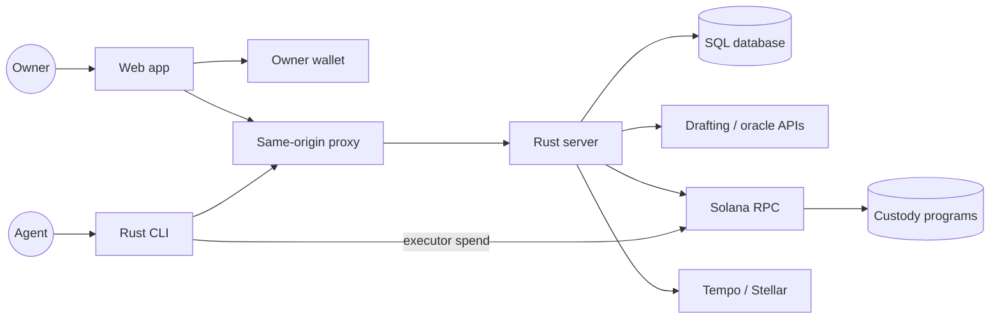
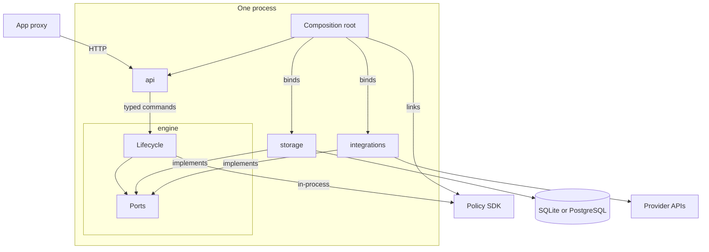
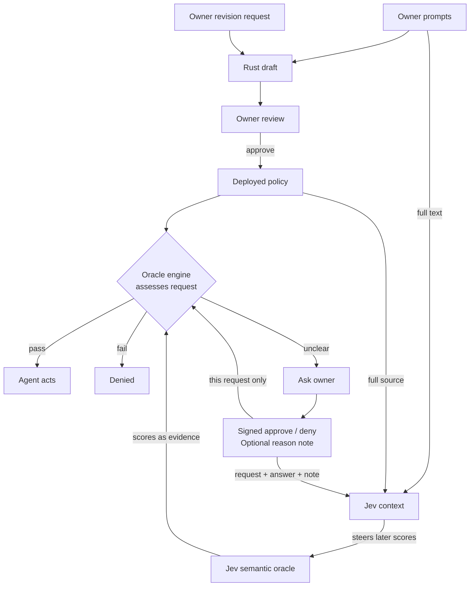
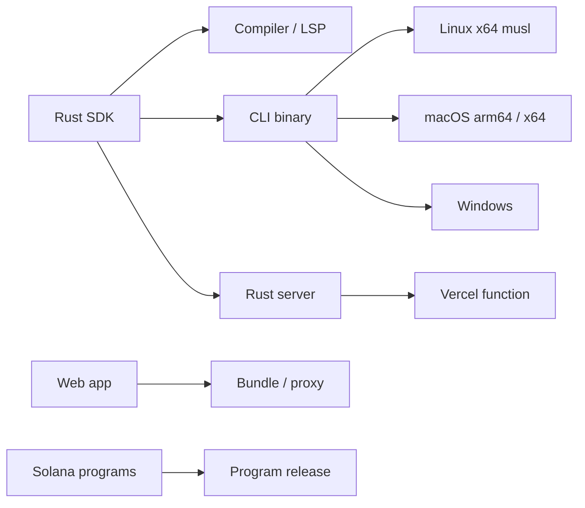
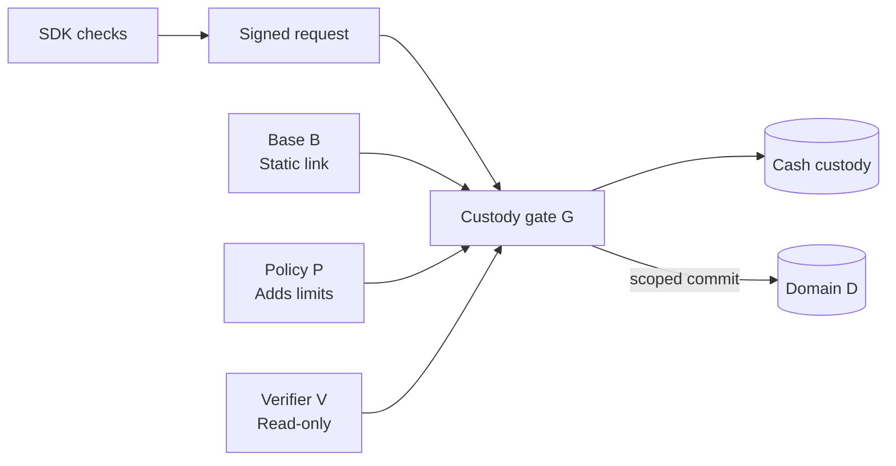

# Architecture

## System Overview

AllowIt places a policy between an AI agent and its owner's funds. The owner sets the terms once. The agent acts inside those terms. When the policy cannot decide, it asks the owner.

### Policy language

Restricted Rust is the single policy source. The compiler checks every branch and emits bounded IR for workflow views and oracle evaluation. A policy ends in pass or fail. Only the oracle can wait for owner input. See [Policy SDK](../doc/policy-sdk.md).

### One backend

The backend is one Rust process with API, engine, storage, integration and provider crates. It links the policy SDK as a library, so no separate policy-engine service adds a hop, deployment or failure mode. The engine owns lifecycle state and defines ports that storage and integrations implement, so dependencies have no cycle.

The private `allowit-engine` repository holds the backend. A native HTTP binary and a Vercel function share one application library. A deployment uses SQLite with persistent local storage, or PostgreSQL in production, because function-local files are not durable.

One Rust process links policy SDK in-process, so no engine HTTP hop or extra service. Engine owns lifecycle state and ports. Storage and integrations implement those ports, so dependencies point inward without cycles. Composition root binds one SQL adapter.

### Independent frontend

The React and TypeScript frontend lives in the private `app.allowIt.xyz` repository, so it deploys independently of the backend. A thin same-origin proxy forwards versioned requests, cookies and original credentials to one fixed backend. Its service credential grants no owner authority. Validation, decisions and transaction preparation stay in Rust.

## Components

### Policy SDK

The [Policy SDK](../doc/policy-sdk.md) has three Rust libraries. `allowit_sdk` compiles restricted Rust to checked IR and evaluates it. `allowit_native` signs Solana transactions and checks receipts. `allowit_tempo` verifies Tempo plans offline. The compiler stays independent of any chain.

### Policy Engine and System Functions

The SDK compiler emits checked IR for exact registered system functions. The Rust backend evaluates the IR with authenticated context, owner rules and bound oracle evidence. Only the host oracle profile can wait for owner input. In an on-chain profile, an owner-input request fails.

Pure policy evaluation performs no HTTP requests and handles no secrets. Host adapters handle credentials and external operations. They reconcile settlement and service delivery. Native custody applies mandatory profile checks independently of owner restrictions. Consumer wallet profiles use offchain evaluation and ordinary wallet transactions without an AllowIt custody contract. Native operation admission fixes the implementation, profile and deployment.

| Component / vendor | Role | Reference |
| --- | --- | --- |
| Rust backend | Authenticated lifecycle state, storage and provider integration ports. | [Backend](https://github.com/AllowIt-hq/allowit.xyz-project/blob/main/wiki/allowit/allowit-rust-server.md) |
| Policy SDK and language | Compiler, checked IR, evaluator, registry and restricted Rust authoring. | [SDK](https://github.com/AllowIt-hq/allowit.xyz-project/blob/main/wiki/allowit/allowit-sdk.md) · [Language](https://github.com/AllowIt-hq/allowit.xyz-project/blob/main/wiki/allowit/rust-policy-language.md) |
| Operation lifecycle | Validation, approved execution and atomic institutional custody enforcement. | [Lifecycle](https://github.com/AllowIt-hq/allowit.xyz-project/blob/main/wiki/allowit/system-functions/lifecycle.md) |
| Application and execution assurance | Policy review, agent handoff and custody and signing profiles. | [App](https://github.com/AllowIt-hq/allowit.xyz-project/blob/main/wiki/allowit/allowit-app.md) · [Assurance](https://github.com/AllowIt-hq/allowit.xyz-project/blob/main/wiki/allowit/execution-assurance.md) |
| Native contracts | Solana and Stellar account validation, custody, authority and activation binding. | [Contracts](https://github.com/AllowIt-hq/allowit.xyz-project/blob/main/wiki/allowit/allowit-contracts.md) |
| AllowIt core | Spending, asset and recipient constraints, owner input and custody checks. | [Core](https://github.com/AllowIt-hq/allowit.xyz-project/blob/main/wiki/allowit/system-functions/core.md) |
| KASE corporate actions | Holder records, snapshots, coupons, redemption, ballots and typed instrument requests. | [Operations](https://github.com/AllowIt-hq/allowit.xyz-project/blob/main/wiki/allowit/system-functions/corporate-actions.md) · [Types](https://github.com/AllowIt-hq/allowit.xyz-project/blob/main/wiki/allowit/system-functions/types/bond.md) |
| Jev | Authenticated preference evidence and threshold checks. | [Preference checks](https://github.com/AllowIt-hq/allowit.xyz-project/blob/main/wiki/allowit/system-functions/core.md#preference-evidence-read) |
| Host / PaySH | HTTP requests, scoped credentials and discovery. Payment challenges, approved requests and separate settlement and delivery reconciliation. | [Host](https://github.com/AllowIt-hq/allowit.xyz-project/blob/main/wiki/allowit/system-functions/host.md) · [Types](https://github.com/AllowIt-hq/allowit.xyz-project/blob/main/wiki/allowit/system-functions/types/paysh.md) |
| Etherfuse | Stablebond discovery, quotes, orders, events and replacement transaction preparation. | [Adapter](https://github.com/AllowIt-hq/allowit.xyz-project/blob/main/wiki/allowit/system-functions/etherfuse.md) |
| Solana | SPL transfers and burns, plus admitted Orca swaps. | [Interfaces](https://github.com/AllowIt-hq/allowit.xyz-project/blob/main/wiki/allowit/system-functions/solana.md) |
| Stellar | Native authorization, token transfers, allowances, burns and vault operations. | [Interfaces](https://github.com/AllowIt-hq/allowit.xyz-project/blob/main/wiki/allowit/system-functions/stellar.md) |
| Tempo | Bond, voting and compliance interfaces, with token and vault bindings. | [Bond and compliance](https://github.com/AllowIt-hq/allowit.xyz-project/blob/main/wiki/allowit/system-functions/tempo.md) · [Token and vault](https://github.com/AllowIt-hq/allowit.xyz-project/blob/main/wiki/allowit/system-functions/tempo-token-vault.md) |

See the [System functions index](https://github.com/AllowIt-hq/allowit.xyz-project/blob/main/wiki/allowit/system-functions/index.md) for contracts and workflow composition.

### Native CLI

The [CLI](https://github.com/AllowIt-hq/allowit-cli/blob/main/README.md) is one Rust binary for agents and owners. Agent commands (`show`, `eval`, `exec`, `status`) ask the backend to decide. Native `policy` commands run the SDK in-process for generation, signing and RPC. The binary needs no Node runtime and links no backend crate.

### Solana Programs

The [Solana contracts](https://github.com/AllowIt-hq/allowit-contracts-solana/blob/main/README.md) supply a shared custody program and an immutable policy program. An operator releases these programs once, and each owner creates vault state under that release.

The native profile is a fixed, approved daily-limit template with owner-set parameters, not arbitrary owner Rust. Generic Rust policies run through the backend oracle. Vault ABI 2 binds owner, executor, server authority, asset, policy version, action limit, daily limit, standing approval and instance slot. Each spend needs the executor and server authority signatures on one transaction. That transaction binds the server's assessment commitment, nonce, revision, instance slot and an expiry of at most 300 seconds. Custody invokes the policy and moves tokens in one atomic transaction, without judging merchant or purpose. This native vault does not use the generic `execute(request)` gate.

### Owner Feedback Lifecycle

Jev is the semantic oracle. It is a model service that scores semantic questions, such as preference fit. The trusted oracle engine in the backend sends Jev each question with bound context, checks the result and evaluates the policy. A Jev result is evidence only. Policy rules, limits and custody checks stay hard checks, and Jev cannot override them.

The backend drafts restricted Rust from owner prompts and checks it with the real compiler. The owner revises through dialogue and approves one revision.

Jev context keeps the full original owner prompts and the full deployed policy. When an assessment is unclear, the owner wallet signs approve or deny for that exact assessed request. The owner can add a reason note of up to 2000 UTF-8 bytes. The signed challenge binds that note. The context keeps the assessed request, the answer and the note for the same policy revision. Jev uses these records to steer later semantic scores. A note grants no authority and cannot override policy limits or hard checks. An answer does not change the policy.

A policy revision starts only from an explicit owner request. The backend makes a new draft, checks it with the compiler and waits for owner approval. Thus AllowIt never changes a policy silently.

### Rust Backend

The [engine repository](https://github.com/AllowIt-hq/allowit-engine/blob/main/README.md) contains the application backend and standalone policy service. The application backend owns authentication, policy and request lifecycles, storage ports and provider coordination. See [One backend](#one-backend) for its process boundary.

### Application Frontend

The [application](https://github.com/AllowIt-hq/app.allowIt.xyz/blob/main/README.md) provides policy authoring, workflow review and private agent handoff. Its same-origin proxy forwards authenticated requests to the Rust backend. See [Independent frontend](#independent-frontend) for the deployment boundary.

### Stellar Contracts

The [Stellar contracts](https://github.com/AllowIt-hq/allowit-contracts-stellar/blob/main/README.md) supply Soroban policy, custody vault and owner-bound factory contracts. Standing approvals and native limits constrain executor transfers. The factory creates vaults from shared Wasm.

### Website

The [website](https://github.com/AllowIt-hq/allowit.xyz/blob/main/README.md) presents the AllowIt narrative and interactive story and directs visitors to the application.

### Knowledge Workspace

The [knowledge workspace](https://github.com/AllowIt-hq/allowit.xyz-project/blob/main/README.md) maintains the canonical wiki, original sources, tooling and repository registry for developer operations.

### Packaging and Platforms

The CLI packages one `allowit` binary per platform. Platform targets are Linux x64, macOS Apple Silicon, macOS Intel and Windows. The Linux musl build avoids dynamic runtime dependencies. The backend runs as a Vercel function, native binary or container, and the frontend has its own Vercel project. The SDK pins accepted Solana program identities.

### Corporate Actions and Rails

**KASE corporate actions.** The `corporate_actions` domain covers coupons, maturity redemption and advisory holder votes. Holder positions stay in program custody. Each record date seals an immutable snapshot. Later transfers cannot change entitlements fixed at cutoff. A typed ABI derives each payment and burn with checked integer arithmetic. Exact integers give every party the same result and prevent rounding differences between implementations.

**Execution profiles.** Two profiles stay separate. The native daily-limit vault uses its own vault ABI for standing-approval spends. The general institutional custody gate serves corporate actions through one entrypoint, `execute(request)`. The SDK checks policy offchain and signs the exact request. The gate rechecks mandatory invariants against current chain state and applies all effects atomically. It then verifies cash, burn and domain deltas. A failed check or delta mismatch reverts all effects.

**Module roles.** These labels are roles, not contract methods:

- **G, custody gate.** Holds cash custody, budgets, replay state and settlement receipts. Only G moves cash, so financial effects stay in one checked place.
- **D, domain state.** Holds positions, snapshots, obligations, ballots and bond escrow. D never receives the G cash signer, so it cannot sign cash transfers. Holder operations require holder consent. Initialization and issuance require approved issuer authority.
- **B, shared base.** Read-only common checks for binding, approval, replay, budget and effect bounds. B links statically into G. The execute path always runs these checks. Static linking avoids a separate deployment and cross-program call for B.
- **P, owner policy.** Adds restrictions. It never removes mandatory native checks.
- **V, vendor verifier.** Read-only. It supplies admitted facts, such as `etherfuse` order data, and holds no custody signer.

**Module binding.** Each module identity binds its exact namespace, version and rail deployment. This binding is immutable after release. A substituted module or redeployed program cannot satisfy a signed request. A namespace prefix grants no authority.

**Rails.** Rail adapters isolate differences in network, asset, fees, signature format and clock. Adapters preserve portable rule semantics while binding each rail’s native constraints. Each approved rail or profile binds its exact native constraints. Solana, Stellar and Tempo keep separate profiles.

## Chain deployment choices

### On-chain policy enforcement: smart-contract wallet vs simple wallet

AllowIt supports two wallet models. Each model enforces policy in a different place. The choice depends on value at risk and on the need for independent limits.

A simple wallet uses one isolated signer and an offchain policy service. The service checks each proposed transaction before the signer signs it. This model costs less to deploy and operate because it needs no custom custody contract. The agent receives no spending key. A compromised signer or policy service can bypass the offchain restrictions. A simple wallet provides less independent protection than a contract wallet.

A smart-contract wallet keeps funds in a custody contract. The contract applies mandatory native profile limits atomically at execution, independent of offchain assessment. It rejects a signed request that violates those limits. This model has higher deployment, execution and storage cost.

| Wallet | Enforcement | Cost | Preferred use |
| --- | --- | --- | --- |
| Simple wallet | Offchain policy service and isolated signer. | Lower deployment and operating cost. Normal transaction fees. | Consumer and lower-value workflows that accept trust in signer and policy service. |
| Smart-contract wallet | Custody contract applies mandatory native limits atomically at execution. | Higher deployment, execution and storage cost. | Higher-value and institutional workflows that need independent limits. |

Contract safety depends on the concrete constraints that the contract enforces, such as amount, recipient and budget. Semantic oracle assessment remains an offchain responsibility.

Solana, Stellar and Tempo use separate profiles for native constraints, fees and clocks.

See [commands](api.md) for operational use.
