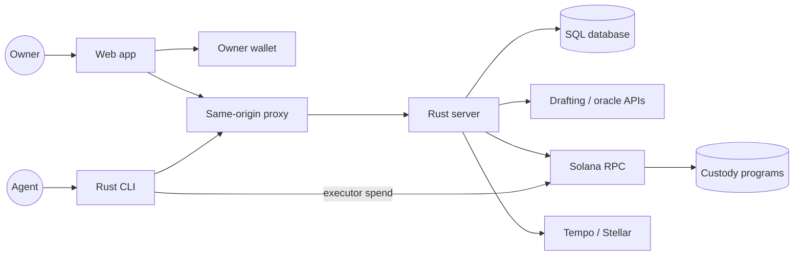
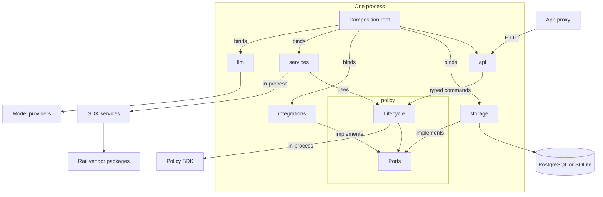
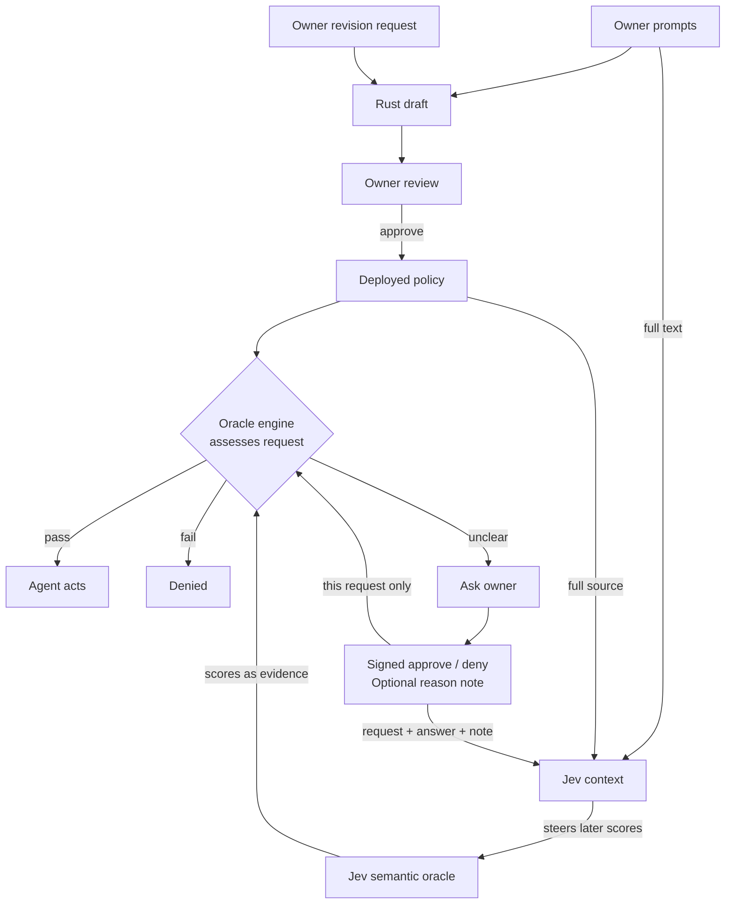
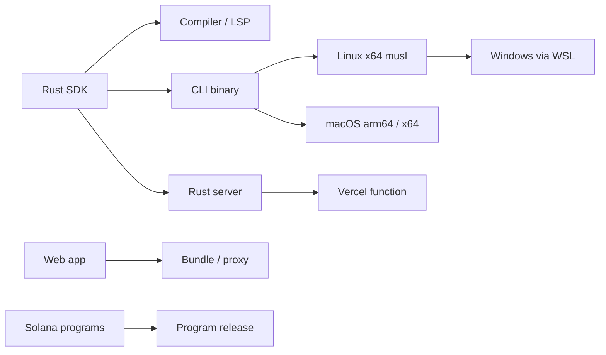

# Architecture

## System Overview

AllowIt places a policy between an AI agent and its owner's funds. The owner sets the terms once. The agent acts inside those terms. When the policy cannot decide, it asks the owner.

### Policy language

One Rust source defines each policy. Its entry point is `pub fn execute(ctx: &AllowitEnv) -> allowit::Result`. The function is synchronous. Its doc comment holds the owner's original prompt. `AllowitEnv` carries the typed owner Grant, protected state and the authenticated request.

Each rule call has one form: `allowit::<rule>(ctx, &ctx.grant.<rule>)?`. A rule returns only its passing constraint or an error. A cap returns the amount left. An allowlist returns the matched address. `expiry` returns the seconds left. An unset Grant value denies with `MissingGrant`.

| Rule | Owner limit |
| --- | --- |
| `transaction_cap` | Gross debit of one operation |
| `spent_cap` | Irreversible expenses over the policy life, including fees, gas and realized loss |
| `day_spent_cap` | Irreversible expenses in one UTC day |
| `day_total_cap` | Gross amount plus gas in one UTC day |
| `call_cap` | Successful operations |
| `recipients` | Allowed destination addresses |
| `tokens` | Allowed exact assets |
| `expiry` | Last time for execution |

The same source compiles unchanged for three targets: the server, custom contracts and the standard contract preflight. The preflight runs only the consecutive leading rule calls and skips unset Grant fields. All other code runs on the server or in a custom contract. A policy ends in pass or fail. Only the server oracle can wait for owner input. See [Policy SDK](policy-sdk.md).

### One backend

The application server is one Rust process. It links the policy SDK and the SDK service facade as libraries, so policy evaluation adds no network hop, deployment or failure mode. Its packages are `api`, `policy`, `services`, `storage`, `integrations`, `llm` and model-provider adapters. The `policy` package owns lifecycle state and defines ports. The `api`, `services`, `storage`, `integrations` and `llm` packages depend on `policy`. Storage and integrations implement its ports, so dependencies point inward without cycles.

The private `allowit-engine` repository holds the backend. A native HTTP binary and a Vercel function share one application library. A deployment uses PostgreSQL, or SQLite with persistent local storage, because function-local files are not durable. The same repository holds two separate services: a standalone policy oracle and a policy authoring agent.

The composition root binds one SQL adapter, the integrations, the services and the model providers. The `policy` package calls the policy SDK in-process. The `services` package coordinates paid operations through the SDK service facade, which delegates to rail vendor packages.

### Independent frontend

The React and TypeScript frontend lives in the private `app.allowIt.xyz` repository, so it deploys independently of the backend. A thin same-origin proxy forwards versioned requests, cookies and original credentials to one fixed backend. Its service credential grants no owner authority. Validation, decisions and transaction preparation stay in Rust.

## Components

### Policy SDK

The [SDK](https://github.com/AllowIt-hq/allowit-sdk/blob/main/README.md) splits into Rust crates. `allowit-sdk` checks and compiles policy source. `allowit-client` is the client facade for the CLI. `allowit-native` builds and signs Solana transactions and checks receipts. `allowit-services` gives the server one interface to service vendors and rail protocols. Rail vendor crates live in their rail repositories. The compiler has no chain dependency. See [Policy SDK](policy-sdk.md).

### Policy Engine and System Functions

Pure policy evaluation holds no credentials and makes no network calls. Host adapters authenticate context and evidence, prepare external operations and reconcile settlement and service delivery. Native custody adds mandatory profile checks. Consumer wallets use server evaluation and ordinary wallet transactions.

Vendor integrations, such as PaySH and Etherfuse, belong outside the core repositories, in their own `vendor-<name>` repository or in their rail repository. A well-abstracted rail covers basic swap, rebalance and data enrichment operations natively, without a vendor package.

### Native CLI

The [CLI](https://github.com/AllowIt-hq/allowit-cli/blob/main/README.md) is one Rust binary for agents and owners. Its only runtime dependency is the SDK client facade, which links the compiler, the native Solana client and the rail vendor crates. Agent commands (`show`, `eval`, `exec`, `status`) ask the backend to decide. Native `policy` commands run the SDK in-process for generation, signing and RPC. `paysh` and `tempo` commands serve rail operations under an existing policy. `wallet` generates and keeps agent keys locally. The binary needs no Node runtime and links no backend crate. Go code in the repository is only a reference for tests.

### Solana Programs

The [Solana contracts](https://github.com/AllowIt-hq/allowit-contracts-solana/blob/main/README.md) supply three programs: a shared custody vault, an immutable policy helper and a separate PaySH program. An operator releases the vault and policy programs once, and each owner creates vault state under that release.

The native vault profile is a fixed, approved template with owner-set parameters, not arbitrary owner Rust. The policy helper runs `require_approval(ctx)?; enforce_daily_limit(ctx)`. Vault ABI 2 binds owner, executor, server authority, asset, policy version, action limit, daily limit, standing approval and instance slot. `action_limit` caps one transfer. `daily_limit` caps gross transfers in one UTC day, up to 50,000,000 units. A zero daily limit pauses spending. Each spend needs the executor and server authority signatures on one transaction. That transaction binds the server's assessment commitment, nonce, revision, instance slot and an expiry of at most 300 seconds. Custody invokes the policy and moves tokens in one atomic transaction, without judging merchant or purpose.

The PaySH program makes bounded USDC payments to one approved vendor and swaps SOL to USDC through one pinned Orca Whirlpool pool. It verifies an evaluator-signed `execute(request)`, an owner-committed service allowlist, replay receipts, period budgets and exact effects. It keeps its own ABI, counters and recovery path. Unlike the vault and policy programs, PaySH is upgradeable, so its recorded upgrade authority controls its custody.

Native parameters carry the canonical rules:

| Canonical rule | Native vault | PaySH |
| --- | --- | --- |
| `transaction_cap` | `action_limit` | Server |
| `day_total_cap` | `daily_limit` | Server |
| `tokens` | Bound mint | Configured USDC mint |
| `recipients` | Server | `vendor_usdc` and `service_allowlist_root` |
| `expiry` | Server | `policy_expires_timestamp` |

`spent_cap`, `day_spent_cap` and `call_cap` run on the server for both programs. PaySH also enforces its own per-call, period and lifetime budgets.

Host crates in the same repository run offchain. The Solana vendor crate gives the SDK client facade its Solana adapters. Service packages give the SDK service facade the PaySH catalog, payment protocols, x402 packets, typed RPC requests and service providers.

### Owner Feedback Lifecycle

Jev is the semantic oracle. It is a model service that scores semantic questions, such as preference fit. The trusted oracle engine in the backend sends Jev each question with bound context, checks the result and evaluates the policy. A Jev result is evidence only. Policy rules, limits and custody checks stay hard checks, and Jev cannot override them.

The backend drafts policy source from owner prompts and checks it with the real compiler. The owner revises through dialogue and approves one revision.

Jev context keeps the full original owner prompts and the full deployed policy. When an assessment is unclear, the owner wallet signs approve or deny for that exact assessed request. The owner can add a reason note of up to 2000 UTF-8 bytes. The signed challenge binds that note. The context keeps the assessed request, the answer and the note for the same policy revision. Jev uses these records to steer later semantic scores. A note grants no authority and cannot override policy limits or hard checks. An answer does not change the policy.

A policy revision starts only from an explicit owner request. The backend makes a new draft, checks it with the compiler and waits for owner approval. Thus AllowIt never changes a policy silently.

### Rust Backend

The [engine repository](https://github.com/AllowIt-hq/allowit-engine/blob/main/README.md) contains the application backend, a standalone policy oracle and a policy authoring agent. The application backend owns authentication, policy and request lifecycles, storage ports, paid-operation coordination and provider coordination. The oracle has its own workspace and SDK revision. The authoring agent serves policy drafts over ACP and A2A through the same policy author and compiler. See [One backend](#one-backend) for the process boundary.

### Application Frontend

The [application](https://github.com/AllowIt-hq/app.allowIt.xyz/blob/main/README.md) provides policy authoring, workflow review and private agent handoff. Its same-origin proxy forwards authenticated requests to the Rust backend. See [Independent frontend](#independent-frontend) for the deployment boundary.

### Stellar Contracts

The [Stellar contracts](https://github.com/AllowIt-hq/allowit-contracts-stellar/blob/main/README.md) supply owner-controlled Soroban policy wallets. Standard wallets run canonical rule checks, and custom wallets compile their own policy. All wallets share custody and administration code.

### Website

The [website](https://github.com/AllowIt-hq/allowit.xyz/blob/main/README.md) presents the AllowIt narrative and interactive story and directs visitors to the application.

### Knowledge Workspace

The [knowledge workspace](https://github.com/AllowIt-hq/allowit-project) maintains the canonical wiki, original sources, tooling and repository registry for developer operations.

### Packaging and Platforms

The CLI packages one `allowit` binary per platform: Linux x64, macOS Apple Silicon and macOS Intel. Windows uses the Linux build under WSL. The CLI refuses unsupported platforms. The Linux musl build avoids dynamic runtime dependencies. The backend runs as a Vercel function, native binary or container, and the frontend has its own Vercel project. The SDK pins accepted Solana program identities.

### Corporate Actions and Rails

**KASE corporate actions.** KASE is a separate application in the `AllowIt-hq/kase` repository. It runs under an AllowIt policy. Its native Rust Solana program services tokenized bonds: coupons, maturity redemption and holder votes. Holder positions stay in program custody. Each record date seals an immutable snapshot. Later transfers cannot change entitlements fixed at cutoff. Checked integer arithmetic derives each payment and burn, so every party gets the same result. The program also holds the owner limits, so they apply when the agent or backend fails. A KASE service crate applies the policy gate and serves the agent API.

**Rails.** Rail adapters isolate differences in network, asset, fees, signature format and clock. Adapters preserve portable rule semantics while binding each rail's native constraints. Each approved rail or profile binds its exact native constraints. Solana, Stellar and Tempo keep separate profiles.

## Chain deployment choices

### On-chain policy enforcement: smart-contract wallet vs simple wallet

AllowIt supports two wallet models. Each model enforces policy in a different place. The choice depends on value at risk and on the need for independent limits.

A simple wallet uses one isolated signer and an offchain policy service. The service checks each proposed transaction before the signer signs it. This model costs less to deploy and operate because it needs no custom custody contract. The agent receives no spending key. A compromised signer or policy service can bypass the offchain restrictions. A simple wallet provides less independent protection than a contract wallet.

A smart-contract wallet keeps funds in a custody contract. The contract applies mandatory native profile limits atomically at execution, independent of offchain assessment. It rejects a signed request that violates those limits. This model has higher deployment, execution and storage cost.

| Wallet | Enforcement | Cost | Preferred use |
| --- | --- | --- | --- |
| Simple wallet | Offchain policy service and isolated signer. | Lower deployment and operating cost. Normal transaction fees. | Consumer and lower-value workflows that accept trust in signer and policy service. |
| Smart-contract wallet | Custody contract applies mandatory native limits atomically at execution. | Higher deployment, execution and storage cost. | Higher-value and institutional workflows that need independent limits. |

Contract safety depends on the concrete constraints that the contract enforces, such as amount, recipient and budget. Semantic oracle assessment remains an offchain responsibility.

See [commands](api.md) for operational use.
