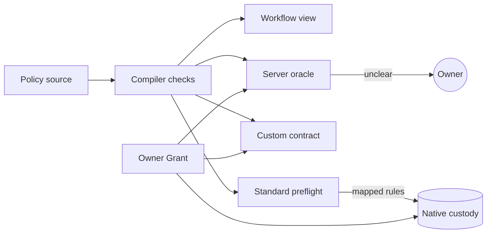

# Policy SDK

The AllowIt Policy SDK checks, compiles and evaluates owner policies. An owner policy is one Rust source. The compiler checks each policy before owner approval. The same source then compiles unchanged for each execution target.

See [architecture](architecture.md) for system boundaries and the [SDK README](https://github.com/AllowIt-hq/allowit-sdk/blob/main/README.md) for source references.

## Rust crates

| Package | Responsibility |
| --- | --- |
| `allowit-sdk` | Compiler, function registry, workflow projection, developer CLI and language server |
| `allowit-client` | Client facade for the CLI: orchestration, vendor selection, receipt checks and recovery |
| `allowit-client-core` | Shared client errors, configuration and private storage |
| `allowit-native` | Solana transactions, local signing, RPC, receipt checks and recovery |
| `allowit-services` | Server interface to service vendors and rail protocols |
| `allowit-stellar-wallet` | Stellar wallet client |
| `allowit-tempo` | Tempo rail client over the Tempo vendor crate |
| `allowit-service-core`, `allowit-service-transport` | Shared service types and bounded transports |

The MIT-licensed compiler has no chain dependency. The client and service facades link the Solana and Tempo vendor crates from their rail repositories at exact revisions. The Solana vendor and PaySH service packages live in the Solana contracts repository.

The server uses the compiler, the native Solana client, other rail clients and the service facade. The CLI uses only the client facade.

## Vendor boundary

Vendor integrations, such as PaySH and Etherfuse, belong outside the core repositories, in their own `vendor-<name>` repository or in their rail repository. A well-abstracted rail covers basic swap, rebalance and data enrichment operations natively, without a vendor package.

## Policy source

A policy is one public, synchronous function:

```rust
/// Pay research vendors up to 10 USDC per purchase and 50 USDC per day.
pub fn execute(ctx: &AllowitEnv) -> allowit::Result {
    // up to 10 USDC per purchase
    allowit::transaction_cap(ctx, &ctx.grant.transaction_cap)?;
    // 50 USDC per day
    allowit::day_total_cap(ctx, &ctx.grant.day_total_cap)?;
    // research vendors
    allowit::recipients(ctx, &ctx.grant.recipients)?;
    Ok(())
}
```

The doc comment holds the owner's original prompt. Each inline comment names the prompt clause that the next call implements. `AllowitEnv` carries the typed owner Grant, proposed protected state and the authenticated request. Grant values hold the owner limits, so a limit change needs no source change.

## Canonical rules

Each rule call has one form: `allowit::<rule>(ctx, &ctx.grant.<rule>)?`. Grant values pass by reference because lists are not `Copy`. A rule is a pure check. Custody commits accounting once, after approval.

| Rule | Owner limit | Pass value |
| --- | --- | --- |
| `transaction_cap` | Gross debit of one operation | Amount left |
| `spent_cap` | Irreversible expenses over the policy life | Amount left |
| `day_spent_cap` | Irreversible expenses in one UTC day | Amount left |
| `day_total_cap` | Gross amount plus gas in one UTC day | Amount left |
| `call_cap` | Successful operations | Operations left |
| `recipients` | Allowed destination addresses | Matched address |
| `tokens` | Allowed exact assets | Matched asset |
| `expiry` | Last time for execution | Seconds left |

A rule returns only its passing constraint or an error. Cap results already include the current request. Other code can use the returned headroom only for additional reservations.

Expenses include fees, gas and realized loss. Retained swap principal is not an expense. `day_total_cap` counts the gross amount, including principal, plus attributable gas.

The policy is conservative. An unset Grant value returns `MissingGrant`. Only the standard preflight runner skips unset values.

Server classifiers return a confidence in 0..=1 or a category name.

## Execution targets



The same source compiles unchanged for three targets:

- **Server.** The server runs the complete policy, including custom code and semantic checks.
- **Custom contract.** A custom contract compiles the complete policy into its own program.
- **Standard preflight.** A standard contract enforces only those consecutive leading rule calls that its native profile maps. It skips unset Grant fields. The server runs all other code. See [Native Solana vault](#native-solana-vault) for the Solana mapping.

A conditional call is custom code. The preflight never turns it into an unconditional native check.

## Compiler bounds

The compiler checks every branch, including unreachable code. It accepts immutable values, conditional statements, early typed failures, checked integer arithmetic and registered functions. It rejects these constructs:

- unregistered or arbitrary calls
- unsupported imports
- recursion, and `while` and `loop` loops
- network and file I/O
- unsafe code
- discarded check results
- reserved `__allowit_` bindings

| Bound | Value |
| --- | --- |
| Source size | 32 KiB |
| Source tokens | 1,024, including delimiters |
| Nodes | 2,048 |
| Depth | 48 |

An unknown vendor prefix cannot resolve through its suffix. A vendor operation needs its own implementation and registration. A namespace prefix grants no authority.

Amounts use exact integer units. Precision loss fails. A rail verifies the bound asset and its real decimals, then normalizes without rounding.

## Evaluation

### Profiles

| Event | Server profile | Contract profile |
| --- | --- | --- |
| All checks pass | Terminal pass for exact request | Contract can perform its bound transfer |
| Check fails | Terminal fail with code | Transaction fails |
| Owner input needed | Waits for authenticated owner input | Fails with `USER_INPUT_REQUIRED` |
| Owner declines or revokes, or request expires | Continuation fails or becomes invalid | No input bypass exists |

A policy ends in pass or fail. Only the trusted server oracle can wait. Funds never wait inside a contract for a human. A contract input call fails even when the caller supplies an answer.

### Semantic evidence

A preference check asks Jev one literal question. The source cannot substitute a score. The owner sets a deny threshold and an approve threshold. A score at or below the deny threshold denies. A score at or above the approve threshold passes. A score between them asks the owner. The host accepts only one number in [0,1] from the provider. This is a point score, not a calibrated confidence interval.

### Host authority

Policy evaluation is pure. It makes no network call, holds no secrets and reads no files. It cannot ask Jev, sign, settle or read external state.

Missing evidence returns `SEMANTIC_EVIDENCE_REQUIRED` with question and key metadata. The host asks Jev with the exact question, original intent and bound context. It checks and persists the response, then evaluates the same action again. The host must not turn a missing-evidence result into approval. It binds evidence to policy, source, owner, action, amount, recipient, network, asset, intent, context digest and expiry.

The host also manages authorization, budgets and recovery. It enforces replay protection, expiry, revocation and fresh budgets. It reconciles settlement and service delivery separately.

A pass is not settlement. Executed status needs chain verification or a configured settlement attester. Policy rules, limits and custody checks stay hard checks. Jev scores cannot override them.

## Workflow view

The compiler projects each policy into workflow blocks for the app. A leading rule call becomes a predefined block with help text. Other statements stay as exact custom code, including comments. Source stays byte-for-byte. Each block keeps its source offsets for browsers and the language server.

## Command-line tools

Two different command-line tools exist. Do not use one in place of the other.

### SDK developer CLI

The SDK developer CLI compiles, evaluates, projects workflows, prints the registry and runs the language server. It prints JSON. Its `lsp` command provides diagnostics, hover, completion and a custom `allowit/workflow` request over stdio JSON-RPC.

### Rust action CLI

The [action CLI](https://github.com/AllowIt-hq/allowit-cli/blob/main/README.md) is one Rust binary for agents and owners. It calls the SDK client facade for agent transport, local signing and rail operations. Agent commands `show`, `eval`, `exec` and `status` ask the backend to decide. Native `policy` commands run the SDK in-process for generation, signing and RPC. The binary needs no Node runtime and links no backend crate.

## Native Solana vault

Profile `solana-native-v2` runs a fixed daily-limit template with owner parameters. It does not compile arbitrary prompt-authored Rust or deploy a new executable for each wallet. Its lifecycle accepts explicit Solana Devnet and Testnet bindings.

Vault ABI 2 binds owner, executor, server authority, asset, limits, standing approval, revision and instance slot. Each spend requires executor and server signatures on the same transaction. The transaction binds assessment commitment, nonce and an expiry of at most 300 seconds. Custody checks policy and transfers tokens atomically. It does not judge merchant or purpose.

Vault parameters carry the native canonical rules:

| Canonical rule | Vault parameter |
| --- | --- |
| `transaction_cap` | `action_limit` |
| `day_total_cap` | `daily_limit`, gross transfers per UTC day; server adds gas |
| `tokens` | Bound mint |

The owner can tune both limits after setup. A zero daily limit pauses spending. All other rules run on the server. See [Solana Programs](architecture.md#solana-programs) for the PaySH program.

Generic contract adapters instead check a stored, compiler-authorized policy artifact. They do not parse source on-chain. See [contract adapters](https://github.com/AllowIt-hq/allowit-sdk/blob/main/contracts/README.md).
