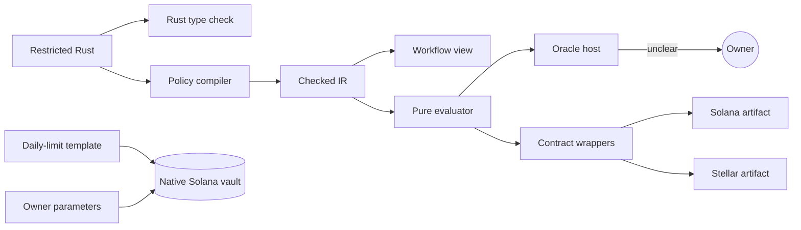

# Policy SDK

The AllowIt Policy SDK compiles and evaluates owner policies. An owner writes policies in a restricted subset of Rust. The compiler checks each policy before use. The SDK turns approved source into checked IR. It then evaluates that IR against authenticated request context.

See [architecture](architecture.md) for system boundaries and the [SDK README](https://github.com/AllowIt-hq/allowit-sdk/blob/main/README.md), [SDK reference](https://github.com/AllowIt-hq/allowit.xyz-project/blob/main/wiki/allowit/allowit-sdk.md) and [policy language](https://github.com/AllowIt-hq/allowit.xyz-project/blob/main/wiki/allowit/rust-policy-language.md) for source references.

## Rust libraries

| Package | Library | Manifest | Responsibility |
| --- | --- | --- | --- |
| `allowit-sdk` | `allowit_sdk` | [Cargo.toml](https://github.com/AllowIt-hq/allowit-sdk/blob/main/Cargo.toml) | Compiler, checked IR, deterministic evaluator, function registry, workflow projection, developer CLI and language server |
| `allowit-native` | `allowit_native` | [native-rust/Cargo.toml](https://github.com/AllowIt-hq/allowit-sdk/blob/main/native-rust/Cargo.toml) | Solana transactions, local signing, RPC, receipt checks and recovery |
| `allowit-tempo` | `allowit_tempo` | [tempo-rust/Cargo.toml](https://github.com/AllowIt-hq/allowit-sdk/blob/main/tempo-rust/Cargo.toml) | Offline verification of Tempo vault plans and authority signatures |

The MIT-licensed compiler has no chain dependency. Its developer binary requires the `compiler` feature.

`allowit_tempo` holds no keys and makes no RPC calls. It does not broadcast transactions or prove HTTP service delivery.

The server engine uses `allowit_sdk` and `allowit_native`. The standalone oracle uses `allowit_sdk`. The Rust action CLI uses all three libraries.

### Cargo features

Default builds enable `std`, `compiler` and `oracle-ledger`. The `compiler` feature includes typed workflows and source parsing. No-default-feature builds retain the deterministic evaluator with `no_std + alloc`. `compact-contract-validation` retains error codes without detailed contract messages.

## Component map

The policy SDK is one component in a larger system. This table lists the components that policy code and host adapters interact with.

| Component / vendor | Role | Reference |
| --- | --- | --- |
| Rust backend | Authenticated lifecycle state, storage and provider integration ports. | [Backend](https://github.com/AllowIt-hq/allowit.xyz-project/blob/main/wiki/allowit/allowit-rust-server.md) |
| Policy SDK and language | Compiler, checked IR, evaluator, registry and restricted Rust authoring. | [SDK](https://github.com/AllowIt-hq/allowit.xyz-project/blob/main/wiki/allowit/allowit-sdk.md) · [Language](https://github.com/AllowIt-hq/allowit.xyz-project/blob/main/wiki/allowit/rust-policy-language.md) |
| Operation lifecycle | Validation, approved execution and atomic institutional custody enforcement. | [Lifecycle](https://github.com/AllowIt-hq/allowit.xyz-project/blob/main/wiki/allowit/system-functions/lifecycle.md) |
| Application and execution assurance | Policy review, agent handoff and custody and signing profiles. | [App](https://github.com/AllowIt-hq/allowit.xyz-project/blob/main/wiki/allowit/allowit-app.md) · [Assurance](https://github.com/AllowIt-hq/allowit.xyz-project/blob/main/wiki/allowit/execution-assurance.md) |
| Native contracts | Solana and Stellar account validation, custody, authority and activation binding. | [Contracts](https://github.com/AllowIt-hq/allowit.xyz-project/blob/main/wiki/allowit/allowit-contracts.md) |
| AllowIt core | Spending, asset and recipient constraints, owner input and custody checks. | [Core](https://github.com/AllowIt-hq/allowit.xyz-project/blob/main/wiki/allowit/system-functions/core.md) |
| KASE corporate actions | Holder records, snapshots, coupons, redemption, ballots and typed instrument requests. | [Operations](https://github.com/AllowIt-hq/allowit.xyz-project/blob/main/wiki/allowit/system-functions/corporate-actions.md) · [Types](https://github.com/AllowIt-hq/allowit.xyz-project/blob/main/wiki/allowit/system-functions/types/bond.md) |
| Jev | Authenticated preference evidence and threshold checks. | [Preference checks](https://github.com/AllowIt-hq/allowit.xyz-project/blob/main/wiki/allowit/system-functions/core.md#preference-evidence-read) |
| Host / PaySH | HTTP requests, scoped credentials and discovery. Payment challenges, approved requests and separate settlement and delivery reconciliation. | [Host](https://github.com/AllowIt-hq/allowit.xyz-project/blob/main/wiki/allowit/system-functions/host.md) · [Types](https://github.com/AllowIt-hq/allowit.xyz-project/blob/main/wiki/allowit/system-functions/types/paysh.md) |
| Etherfuse | Stablebond discovery, quotes, orders, events and replacement transaction preparation. | [Adapter](https://github.com/AllowIt-hq/allowit.xyz-project/blob/main/wiki/allowit/system-functions/etherfuse.md) |
| Solana | SPL transfers and burns, plus admitted Orca swaps. | [Interfaces](https://github.com/AllowIt-hq/allowit.xyz-project/blob/main/wiki/allowit/system-functions/solana.md) |
| Stellar | Native authorization, token transfers, allowances, burns and vault operations. | [Interfaces](https://github.com/AllowIt-hq/allowit.xyz-project/blob/main/wiki/allowit/system-functions/stellar.md) |
| Tempo | Bond, voting and compliance interfaces, with token and vault bindings. | [Bond and compliance](https://github.com/AllowIt-hq/allowit.xyz-project/blob/main/wiki/allowit/system-functions/tempo.md) · [Token and vault](https://github.com/AllowIt-hq/allowit.xyz-project/blob/main/wiki/allowit/system-functions/tempo-token-vault.md) |

See the [System functions index](https://github.com/AllowIt-hq/allowit.xyz-project/blob/main/wiki/allowit/system-functions/index.md) for contracts and workflow composition.

## Why restricted Rust

1. **One mandate source.** The owner approves one policy source. Shared checks keep workflow views and backend evaluation consistent.
2. **Bounded checks.** The compiler accepts only a checked subset. Execution is deterministic, with bounded size, depth and integer arithmetic.
3. **Readable policies.** Compiler output drives workflow blocks in the app. Predefined calls get help text. Other code stays visible as custom code.
4. **Shared libraries.** The backend and CLI embed the libraries for their profile. Contract adapters reuse the deterministic evaluator.
5. **Chain targets.** Solana and Stellar programs use Rust. Each target still needs its own output, ABI and runtime binding.

### Compiled source versus authored execution

The SDK never runs the authored Rust function as native code. Ordinary Rust compilation only type-checks the source through a facade. The restricted compiler parses the same source and lowers it to checked IR. The evaluator interprets that IR with checked arithmetic.

The policy template follows this rule. Its host wrapper builds ordinary Rust, compiles the exact source through the policy compiler and evaluates checked IR. Rust type-checking alone does not authorize an action.



## Source shape

A complete policy has four parts:

1. It imports `allowit::v1::prelude::*`.
2. It declares `struct PolicyParams`.
3. It initializes approved configuration in private `fn new() -> PolicyParams`.
4. It holds rules in private `async fn _execute(ctx: &Context, params: &PolicyParams) -> PolicyResult`.

The [policy template](https://github.com/AllowIt-hq/allowit-sdk/blob/main/templates/policy/README.md) provides these hooks. Its default handler denies every request. Replace `src/policy.rs` with a complete policy and retain its wrapper. The wrapper compiles checked IR rather than directly executing the authored function.

### Result type

`PolicyResult` is `Result<(), PolicyError>`. `Ok(())` reports a successful check. It is not a settlement receipt. `Ok()` is not valid for this type.

Earlier guards use `?;` to propagate failure. A final `cap_per_transaction`, `require_recipient` or `require_merchant` guard can return its result directly. `set_cap_per_day` and `cap_purchase_tiers` need top-level `?;` statements, followed by a result tail.

### Immutable configuration

`PolicyParams` declares every initialized parameter. Immutable fields accept `u64`, `bool`, `&'static str` and bounded `&'static [&'static str]` lists. `new()` initializes every field with a literal. It accepts no caller-supplied configuration object.

Immutable fields become source-bound IR literals. They are not mutable storage. A change to them changes the source hash and needs a new approved artifact. Keep fixed limits inline in `_execute` unless the owner asks for initialized parameters.

### Native mutable limits

Native mutable limits use `OwnerLimit` fields. Only two field and key pairs work:

| Field | Storage key |
| --- | --- |
| `daily_limit` | `native_daily_limit` |
| `action_limit` | `native_action_limit` |

```rust
struct PolicyParams {
    daily_limit: OwnerLimit,
    action_limit: OwnerLimit,
}
fn new() -> PolicyParams {
    PolicyParams {
        daily_limit: allowit::owner_limit("native_daily_limit", 5_000_000),
        action_limit: allowit::owner_limit("native_action_limit", 1_000_000),
    }
}
```

Initial values are integer micro-USDC from 1 through 50,000,000. The constructor binds these initial values into the source hash. `allowit::stored_limit(ctx, params.action_limit)?` returns the current primitive value.

The native adapter owns the typed `Context.native_policy_storage` projection. It checks the declarations against the original installation. It then supplies current account limits after authenticated owner updates. A generic runtime map or a caller number does not establish storage authority.

Native storage is an execution requirement. The oracle native-adapter path must supply verified state. Missing state fails with `NATIVE_STORAGE_REQUIRED`. JSON evaluation rejects a `native_policy_storage` context field with `INVALID_CONTEXT`. The generic contract profile returns `NATIVE_STORAGE_UNSUPPORTED`, also for unreachable reads.

## Registry and version identity

The compiler resolves every call through an exact registry entry. These constants in [`src/types.rs`](https://github.com/AllowIt-hq/allowit-sdk/blob/main/src/types.rs) identify an artifact.

| Constant | Value |
| --- | --- |
| `LANGUAGE` | `allowit-rust-v1` |
| `REGISTRY_VERSION` | `1.5.0` |
| `IR_VERSION` | `1.0.0` |
| `TYPED_IR_VERSION` | `1.1.0` |
| `TOKEN_DECIMALS` | `6` |

`supported_registry_version` accepts only `1.5.0`. Registry 1.5.0 rejects artifacts from earlier registries because daily caps need new authenticated accounting. Regenerate the policy and get owner approval before execution.

### Registered prefixes

The registry recognizes exact `allowit::` and `jev::` aliases, plus retained flat spellings.

An unknown vendor prefix cannot resolve through its suffix. A vendor operation needs its own implementation and registration. A namespace prefix grants no authority.

The `allowit::v1::prelude::*` import supplies source types and Jev aliases. It does not version crate-root function exports. Ordinary Rust code names this facade through `allowit_sdk::v1::prelude`. The import path differs from operation prefixes such as `allowit::set_cap_per_day`.

Qualified calls lower to canonical policy operations. Source spans stay part of artifact identity. A spelling change thus changes source and IR hashes. Recompile the policy and rebind its authorization after a namespace change.

## Compiler bounds

The compiler checks every branch, including unreachable code. It accepts immutable values, conditional statements, early typed failures, checked integer arithmetic and registered functions. It rejects these constructs:

- unregistered or arbitrary calls
- unsupported imports
- mutation, recursion, and `while` and `loop` loops
- `for` loops except over typed workflow collections of at most 64 entries
- network and file I/O
- unsafe code
- discarded check results
- reserved `__allowit_` bindings
- literal suffixes and unsupported syntax

Accounting guards require their exact authenticated context fields. A substituted zero or caller claim cannot replace observed spending.

| Bound | Value |
| --- | --- |
| Source size | 32 KiB (`MAX_SOURCE_BYTES` 32,768) |
| Source tokens | 1,024, including delimiters |
| IR nodes | 2,048 (`MAX_NODES`) |
| IR depth | 48 (`MAX_DEPTH`) |
| JSON wire request | 256 KiB |

## Money, helpers and thresholds

The core USDC profile uses exact six-decimal integer units. Precision loss fails. Other asset precision is not inferred from a symbol. A rail verifies the bound asset and its real decimals, then normalizes without rounding.

### Spending guards

`set_cap_per_day` checks authenticated daily spending and resets at UTC midnight. The compiler hoists this guard before branches and early returns. `cap_per_transaction` limits one payment. Merchant, recipient and asset guards bind exact values. Funding remains an independent host constraint.

### Decimal helpers

Decimal helper parameters must be string literals. Excess precision, invalid syntax and overflow fail without rounding. Helpers lower to existing integer and comparison IR, so rails get no new opcode.

| Helper | Meaning |
| --- | --- |
| `allowit::usdc("25.50")?` | 25.50 USDC, exactly 25,500,000 units, up to six decimals |
| `allowit::percent("85.25")?` | 85.25%, exactly 8,525 basis points, 0 to 100 with up to two decimals |
| `allowit::amount_at_most(ctx.amount_units, "25.50")?` | True when the purchase is at or below 25.50 USDC |
| `allowit::within_percentage_points(candidate, benchmark, "1")?` | True when candidate return is at most one percentage point below benchmark |

`usdc` and `percent` are conversion utilities, not system operations. `within_percentage_points` takes integer basis-point variables or literals. 4% versus 5% passes. Higher returns pass without addition overflow.

`context_u64` reads strict top-level non-negative integer fields. It rejects missing, fractional or string values. The green-investment example limits the expected-return difference to 100 basis points before it asks the preference question.

### Preference thresholds

`jev::preference_evidence(ctx, question)` reads optional trusted evidence. `jev::check_preference(evidence, question, deny_threshold, approve_threshold).await?` compares it. The compiler requires a nested reader with the same literal question. Source cannot substitute a score.

Thresholds are exact decimals in [0,1] with at most four places. Approval and denial include equality. `auto("deny")` resolves to 0.40 and `auto("approve")` to 0.85. Denial must be below approval. `None` disables an outcome. Disabling both asks the owner without model evidence.

A score between thresholds asks the owner. The host accepts the provider result only as `{ "preference_fit": 0.85 }`, one number in [0,1], with no extra fields. Hosts round down to four places. This is a point score, not a calibrated confidence interval.

### Purchase tiers and ledger

```rust
allowit::cap_purchase_tiers(ctx.amount_units, &ctx.token, &ctx.purchase_counts, 1_000_000, 2, "USDC", 6)?;
```

This rule allows two purchases in (0.50, 1], four in (0.25, 0.50] and eight in (0.125, 0.25]. Halving continues to the smallest token unit. No other price floor applies.

The tier rule is one unconditional top-level call. The compiler hoists it before early returns, custom branches and owner questions. The host supplies 40 authoritative price-band counters, including pending reservations. Runtime JSON cannot replace them. Oracle hosts reserve and check counts atomically.

Default SDK, WASM and engine builds include `oracle-ledger`. No-default-feature contract builds reject tier IR with `LEDGER_REQUIRED`. Solana and Stellar adapters reject tier policies because they have no equivalent chain ledger.

## Evaluation

### Context

`Context` contains amount, allocation and consumed-budget units, action, merchant, token, network and current Unix time. Hosts authenticate these facts. Daily caps also need `daily_spent_units` and `spent_day`. Tier policies need authoritative purchase counters. Preference policies need original intent and authenticated evidence.

`original_intent` and `runtime_context` each allow 16 KiB. Runtime JSON allows depth 8 and 128 total object and array entries. Oversize input fails. The SDK does not silently discard fields. Public JSON cannot install verified native storage or provider-call input.

### Decision

`Decision` reports the result. Inspect `outcome`, `code` and `reason`. A pass has outcome `pass` and code `PASS`.

A waiting result includes the owner prompt and input key. Missing Jev evidence includes question and evidence key. Halting spans use UTF-8 byte offsets. Provider effects appear only on a successful path. A provider plan is neither a payment nor a delivery receipt.

### Profiles

| Event | Oracle profile | Contract profile |
| --- | --- | --- |
| All checks pass | Terminal pass for exact request | Wrapper can perform its bound transfer |
| Check fails | Terminal fail with code | Transaction fails |
| Input call reached | Waits for authenticated owner input | Fails with `USER_INPUT_REQUIRED` |
| Owner declines or revokes, or request expires | Continuation fails or becomes invalid | No input bypass exists |

A policy ends in pass or fail. Only the trusted oracle host can wait. Funds never wait inside a contract for a human. A contract input call fails even when the caller supplies an answer. `local:dev` is an oracle-only binding. Contract evaluation rejects it.

### Pure evaluator and host authority

The evaluator is pure. It makes no network call, holds no secrets and reads no files. It cannot ask Jev, sign, settle or read external state.

Missing evidence returns `SEMANTIC_EVIDENCE_REQUIRED` with question and key metadata. The host asks Jev with the exact question, original intent and bound context. It checks and persists the response, then evaluates the same action again.

The host must not turn a missing-evidence result into approval. It binds evidence to policy, source, IR, owner, action, amount, recipient, network, asset, intent, context digest and expiry. A question hash identifies an evidence slot only within one action. It is not a reusable approval token.

The host also manages authorization, budgets and recovery. It enforces replay protection, expiry, revocation and fresh budgets. It reconciles settlement and service delivery separately.

A pass is not settlement. Executed status needs chain verification or a configured settlement attester. Policy rules, limits and custody checks stay hard checks. Jev scores cannot override them.

## Workflow and trace

The compiler emits workflow blocks from registry metadata. An unconditional top-level registered call with literal arguments becomes a predefined block. Contiguous custom statements stay as exact custom code, including comments and nested calls. Source stays byte-for-byte. A top-level preference helper becomes a `preference` block.

Each `WorkflowBlock` has `id`, `kind`, `name`, `label`, `description`, `arguments`, `source`, `start`, `end` and optional `score_thresholds`. Block offsets use UTF-16 code units for browsers and LSP. IR and diagnostic spans use UTF-8 bytes.

Oracle evaluation accepts `trace: true`. The trace binds hashes and reports completion, node status and visited state.

Nodes report `passed`, `failed`, `verifying` or `awaiting_input`. Unvisited nodes are `inactive` while evaluation waits and `skipped` once terminal. Hoisted caps and early returns affect these states. A trace records execution, not settlement. Bind it to its request and revision.

## Embedding API

Native callers use `allowit_sdk::process_value` or `allowit_sdk::process_json`. `process_json` takes a UTF-8 string and returns a string. `process_value` takes and returns a `serde_json::Value`. The CLI, WebAssembly hosts and native engine share this wire interface.

| Operation | Allowed fields | Response |
| --- | --- | --- |
| `registry` | `operation` | `language`, `registry_version`, `functions`, `type_declarations` |
| `compile`, `check`, `workflow` | `operation`, `source` | `policy` |
| `evaluate` | `operation`, `source`, `profile`, `context`, `trace` | `decision`, `source_hash`, `ir_hash`, optional `trace` |
| `edit_preference` | `operation`, `source`, `settings` | Edited `source` and recompiled `policy` |
| `edit_score_thresholds` | `operation`, `source`, `step_id`, `values` | Edited `source` and recompiled `policy` |

Every response has `ok`. A failure carries `error` with `code` and `message`. The API compiles source itself. It rejects any unknown field, including supplied executable IR.

`trace: true` works only with the oracle profile. Context JSON cannot supply `provider_call_input` or `native_policy_storage`. Only trusted typed adapters install these values.

`edit_preference` takes `settings: {step_id, auto_approve, approve_percent, auto_deny, deny_percent}`. Percentages are strings. `edit_score_thresholds` takes all displayed `values` as integers from 0 to 10,000. Hosts authenticate edits. Stale step IDs fail.

### Embedding example

This complete policy limits each payment to 10 USDC from one merchant:

```rust
use allowit::v1::prelude::*;

struct PolicyParams {}
fn new() -> PolicyParams { PolicyParams {} }

async fn _execute(ctx: &Context, params: &PolicyParams) -> PolicyResult {
    allowit::require_merchant(&ctx.merchant, "research.example")?;
    allowit::cap_per_transaction(ctx.amount_units, &ctx.token, 10_000_000, "USDC", 6)
}
```

The evaluate request embeds that source as a JSON string:

```json
{
  "operation": "evaluate",
  "profile": "oracle",
  "source": "use allowit::v1::prelude::*;\n\nstruct PolicyParams {}\nfn new() -> PolicyParams { PolicyParams {} }\n\nasync fn _execute(ctx: &Context, params: &PolicyParams) -> PolicyResult {\n    allowit::require_merchant(&ctx.merchant, \"research.example\")?;\n    allowit::cap_per_transaction(ctx.amount_units, &ctx.token, 10_000_000, \"USDC\", 6)\n}\n",
  "context": {
    "amount_units": 5000000,
    "allocation_units": 100000000,
    "spent_units": 0,
    "action": "research",
    "merchant": "research.example",
    "token": "USDC",
    "network": "devnet",
    "now": 1790590000
  }
}
```

Read `decision.outcome` before any further action. A successful call or process exit does not mean a pass.

### Typed workflows and providers

Enable `typed-workflow` for host workflows and providers. Typed APIs install authenticated records through `Context::install_workflow`. JSON cannot install them.

Provider policies bind an exact asset with `require_asset` or a monetary cap. Each policy supports one `paysh::call`. Typed adapters bind canonical input and settle the exact admitted amount. They enforce payment, swap and fee ceilings and native limits. They also deduplicate execution. Run effects only after a successful in-process evaluation. Contracts reject provider calls.

## WebAssembly ABI

Build the WebAssembly module with these commands:

```sh
rustup target add wasm32-unknown-unknown
cargo rustc --locked --release --lib --target wasm32-unknown-unknown --crate-type cdylib
```

The output is `target/wasm32-unknown-unknown/release/allowit_sdk.wasm`. It exposes the same bounded JSON processing.

| Export | Behavior |
| --- | --- |
| `alloc(len: u32) -> u32` | Allocates an input buffer |
| `process(ptr: u32, len: u32) -> u64` | Processes UTF-8 JSON. High 32 bits hold output pointer. Low 32 bits hold length |
| `dealloc(ptr: u32, len: u32)` | Frees each buffer once, with its original length |

Hosts enforce memory and time limits. They discard an instance after any trap. The WebAssembly build has no Solana signing or recovery.

## Command-line tools

Two different command-line tools exist. Do not use one in place of the other.

### SDK developer CLI

The SDK developer CLI compiles, evaluates, projects workflows, prints the registry and runs the language server. It prints JSON. Use Rust 1.98 or later and the locked dependencies:

```sh
cargo run --locked -- compile examples/research.rs
cargo run --locked -- evaluate examples/research.rs examples/context.json oracle
cargo run --locked -- evaluate examples/approval.rs examples/context.json contract
cargo run --locked -- workflow examples/approval.rs
cargo run --locked -- registry
cargo run --locked -- lsp
```

Examples without semantic evidence return `SEMANTIC_EVIDENCE_REQUIRED`. Contract evaluation fails when it reaches owner input. Inspect `decision.outcome`, not only the process exit code.

The `lsp` command provides diagnostics, hover, completion and the custom `allowit/workflow` request over stdio JSON-RPC. A workflow request accepts `textDocument.uri` or `source`. The CLI `workflow` command returns the same compiler artifact.

### Rust action CLI

The [action CLI](https://github.com/AllowIt-hq/allowit-cli/blob/main/README.md) is one Rust binary for agents and owners. It owns agent transport and local Solana signing. Agent commands `show`, `eval`, `exec` and `status` ask the backend to decide. Native `policy` commands run the SDK in-process for generation, signing and RPC. The binary needs no Node runtime and links no backend crate.

## Native Solana vault

Profile `solana-native-v2` runs a fixed daily-limit template with owner parameters. It does not compile arbitrary prompt-authored Rust or deploy a new executable for each wallet. Its lifecycle accepts explicit Solana Devnet and Testnet bindings.

Vault ABI 2 binds owner, executor, server authority, asset, limits, standing approval, revision and instance slot. Each spend requires executor and server signatures on the same transaction. The transaction binds assessment commitment, nonce and an expiry of at most 300 seconds. Custody checks policy and transfers tokens atomically. It does not judge merchant or purpose.

Generic IR wrappers instead evaluate stored, checked IR under a selected compiler authority. They do not parse source on-chain. Their limits and transport differ from host evaluation. See [contract adapters](https://github.com/AllowIt-hq/allowit-sdk/blob/main/contracts/README.md).

## Tempo offline verifier

`allowit_tempo` checks Tempo plans before signing or recovery. It uses profile `tempo-native-v1`.

| Function | Check |
| --- | --- |
| `validate_policy` | Profile, network and chain, custody addresses, distinct roles, nonzero digests and limits |
| `validate_prepared` | Exact calldata for `execute`, `approve`, `createVault`, `fund`, `revoke` and `withdrawRemaining` |
| `validate_execution_request` | Executor plan matches exact request and raw context bytes |
| `validate_execution_request_mpp` | Also binds an MPP challenge, HTTP request and expiry |
| `execution_request_identity` | Canonical request identity |
| `execution_digest` | EIP-712 digest for domain `AllowIt Tempo Vault`, version `1` |

Accepted networks are `tempo:localnet` with chain 31337 or 42431, and `tempo:testnet` with chain 42431. Owner, executor and authority must differ. Action limit must be positive, and not more than daily limit. Daily limit must not exceed total limit. `units` parses exact decimals with at most six places.

For an executor plan, the verifier recovers the signer from the execution digest. It requires that signer to equal the configured authority. It rejects high-s signatures and noncanonical padding. A changed recipient, amount, action, merchant or context byte fails. A valid plan is still only prepared. The verifier makes no settlement claim.

